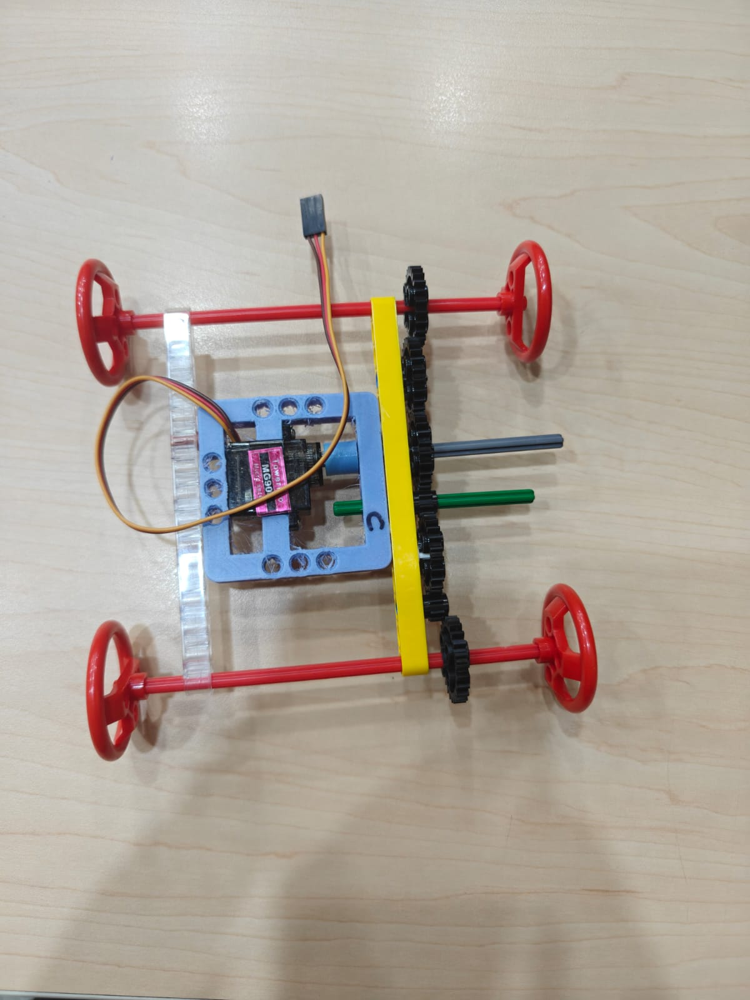
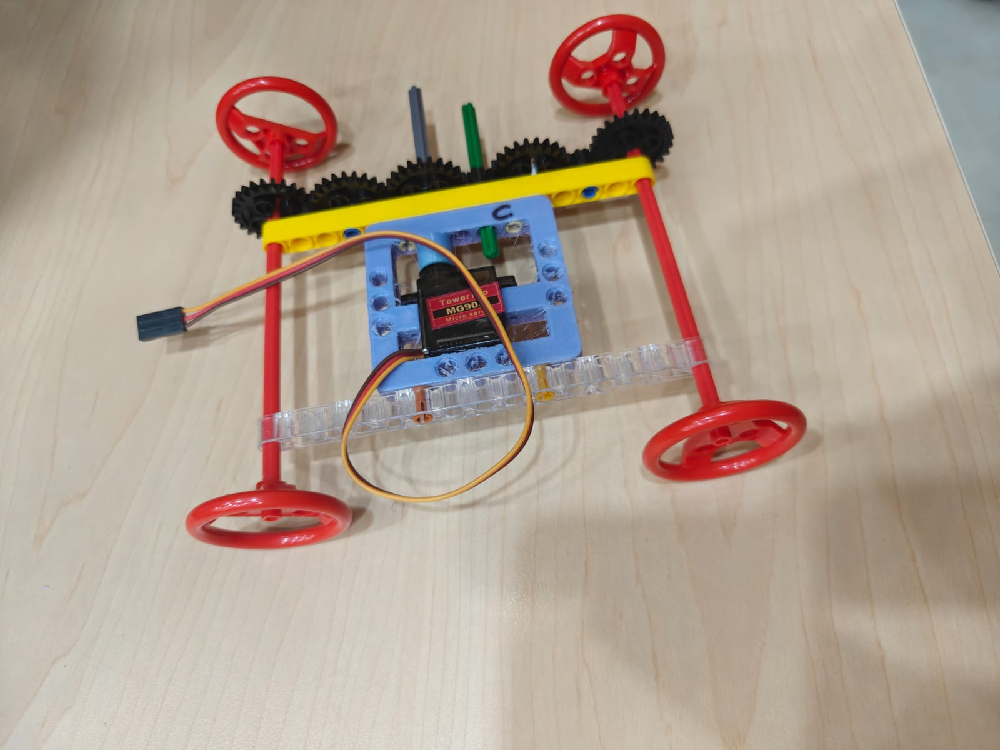
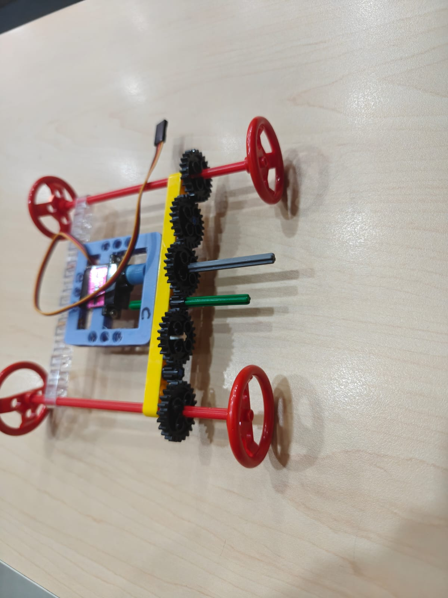
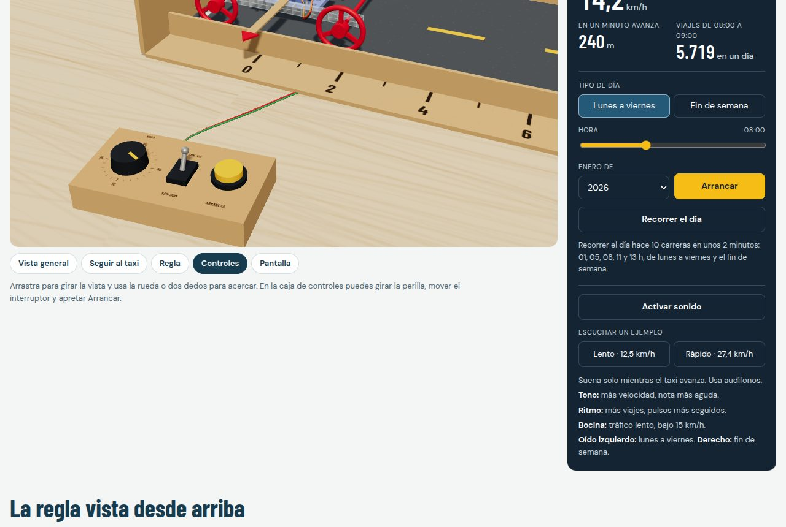
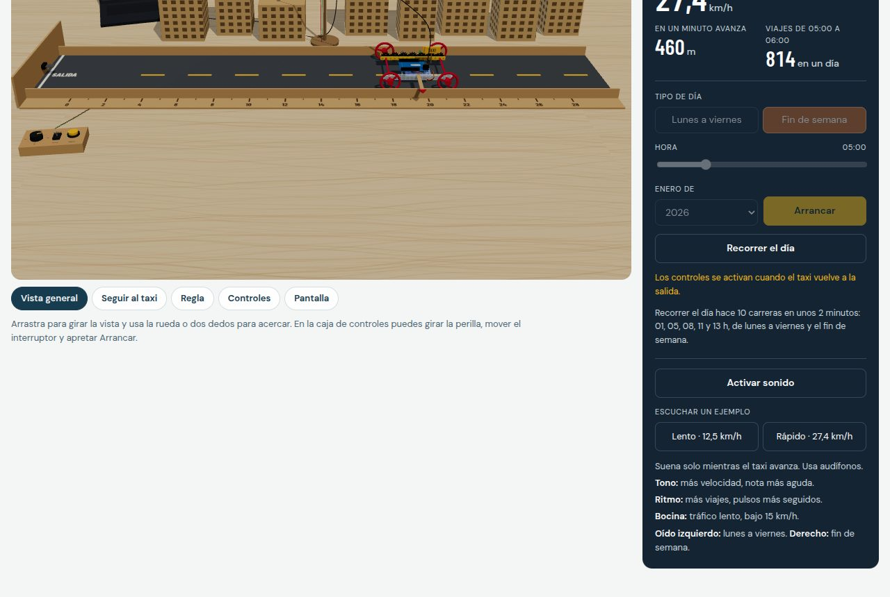
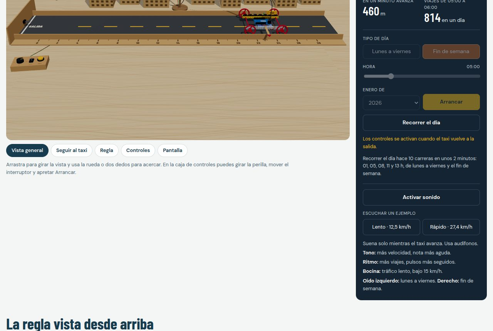
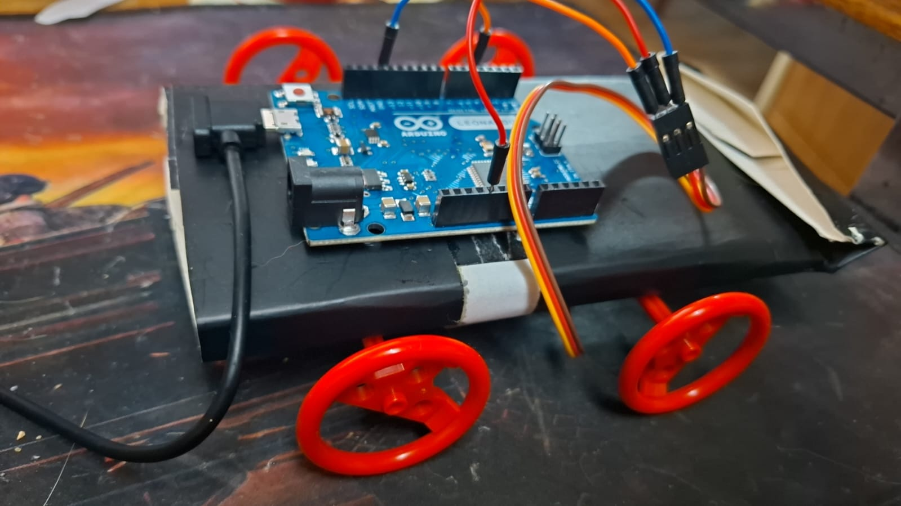
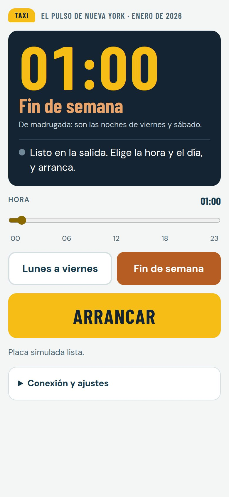
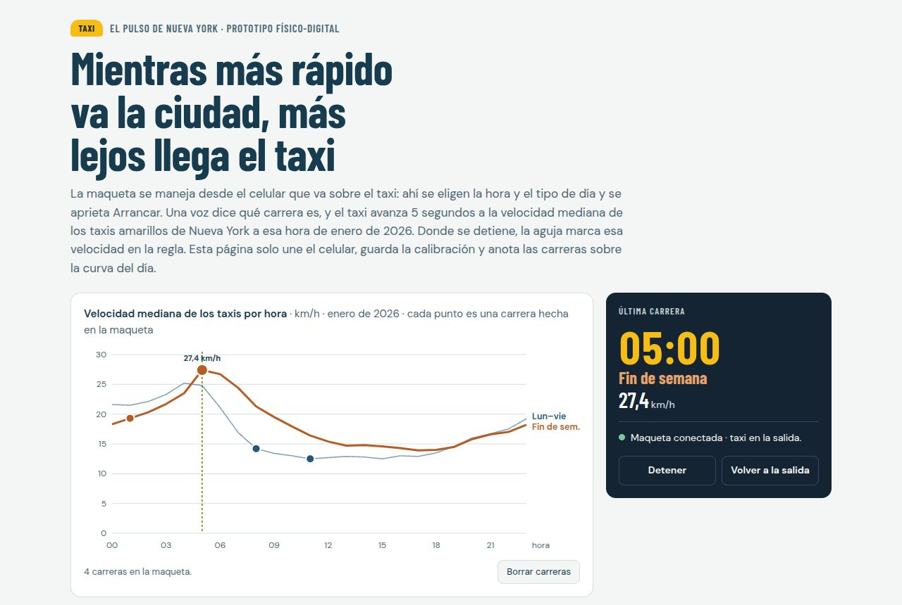

IIC2026 Visualización de Información · Entrega 2 · El proceso de diseño: la visualización salta al mundo físico

<h1>El pulso de Nueva York, en una avenida de cartón</h1>

Un taxi de juguete avanza 5 segundos a la velocidad mediana de los taxis amarillos de Nueva York a la hora que eliges, en enero de 2026. Mismo tiempo, más lejos: más rápido.

<dl>
<dt>Grupo</dt><dd>16</dd>
<dt>Integrantes</dt><dd>Vicente Reñasco · David Parra · Mariano De Sarratea</dd>
<dt>GitHub Pages</dt><dd><a href="https://v1tso.github.io/Visualizacion_de_Informacion_Grupo_16/modelo1/">v1tso.github.io/Visualizacion_de_Informacion_Grupo_16/modelo1/</a> · cada versión en <a href="https://v1tso.github.io/Visualizacion_de_Informacion_Grupo_16/versiones/">/versiones/</a></dd>
<dt>Repositorio</dt><dd><a href="https://github.com/V1TSO/Visualizacion_de_Informacion_Grupo_16">github.com/V1TSO/Visualizacion_de_Informacion_Grupo_16</a> · tags <code>e2-v1</code> a <code>e2-v4</code></dd>
<dt>Video demostrativo</dt><dd>[completar: enlace público de YouTube al video de la V4]</dd>
</dl>

**Orden real del proceso.** V1 (3/11) → R1 (3/11) → V2 (12/11) → R2 (12/11) → V3 (19/11) → R3 (20/11) → V4 (26/11): una versión por semana. Los tags no siguen esta numeración, porque el código de la V2 no se subió al repositorio: la V3 es el tag `e2-v2`, y la V4, los tags `e2-v3` y `e2-v4`. La V4 se terminó el 26 de noviembre, el día de la entrega.

## Contexto general

### Propósito de la fisicalización
<!-- máx 10 -->
En la pantalla de la E1, la velocidad de los taxis era una cifra en el taxímetro y una curva. Se podía leer, pero no se sentía la diferencia entre 12,5 km/h a las 11:00 de un día de semana y 27,4 km/h a las 05:00 del fin de semana (enero de 2026). En la maqueta, la velocidad mediana de cada hora se vuelve distancia: un taxi de juguete avanza 5 s a esa velocidad (28 km/h llega al final de la avenida). En el mismo tiempo, el taxi del fin de semana a las 05:00 llega más del doble de lejos que el de las 11:00 de un día de semana. Desde la V4, la carrera se elige tocando el taxi mismo: el celular que lleva encima es su taxímetro y muestra la hora y el día. El sonido sale del taxi mientras avanza: el tono sigue la velocidad y la bocina marca el tráfico lento. En la R2, el otro grupo destacó que lo físico «permite contrastar la velocidad», mientras que en la pantalla «tiene otros distractores».

### Procesamiento de los datos
<!-- máx 8 -->
- Mismos datos de la E1 (NYC TLC, `public/data/years.json`): velocidad mediana por hora de salida (distancia / duración, viajes de 1 minuto a 3 horas) de toda la ciudad, en un día de lunes a viernes y en uno de fin de semana.
- Ajuste para la maqueta: la distancia va de 0 a 28 km/h. Las horas sobre 28 km/h quedarían al final de la avenida (en enero de 2026 no hay ninguna; el máximo es 27,4).
- V4: solo enero de 2026, en 48 valores dentro del celular (`public/modelo1/datos.js`). Se dejó de sonificar la cantidad de viajes (ver V4).

## V1 — la idea completa (aunque simulada)

### Identificación
3 de noviembre de 2026 · tag [`e2-v1`](https://github.com/V1TSO/Visualizacion_de_Informacion_Grupo_16/tree/e2-v1) (commit `5532f7c`, PR #3) · publicada en [/e2/v1/modelo1/](https://v1tso.github.io/Visualizacion_de_Informacion_Grupo_16/e2/v1/modelo1/).

### Evidencia

[completar: video corto del modelo 3D con sonido (grabación de pantalla de /e2/v1/modelo1/).]

### Qué cambió: las decisiones iniciales
<!-- máx 8 -->
- Fisicalización: la velocidad de la hora elegida se vuelve distancia. El taxi avanza 5 s y su aguja la marca en una regla de 0 a 28 km/h, con una banderita azul (lun–vie) o naranja (fin de semana).
- Interacción: caja con perilla de hora, interruptor de día y botón Arrancar. El taxi vuelve solo, en silencio.
- Sonido en la ida: tono = velocidad, ritmo = viajes, bocina bajo 15 km/h, izquierda/derecha = tipo de día.
- Capa digital: el computador muestra hora, velocidad y curvas. Un Arduino, con un cable colgado de un poste, lee la caja y mueve el servo.
- Prototipo: un chasis de LEGO Technic con un micro servo MG90S y una fila de engranajes que mueve los ejes, todavía sin electrónica, y un modelo 3D interactivo de la maqueta completa (Mago de Oz).

### Por qué cambió — el rationale
<!-- máx 12 -->
- La posición sobre una escala común es la señal que mejor se compara (cap. 16). Por eso la velocidad es una distancia en la regla, y no un ángulo o un color.
- Con el tiempo fijo (5 s), la distancia es proporcional a la velocidad: la metáfora del taxi que «llega más lejos» calza con el dato.
- La vuelta no codifica datos y es siempre igual y en silencio, para que no compita con la ida (cap. 20: solo lo que suma al mensaje).
- El sonido repite la velocidad con el tono y agrega los viajes con el ritmo (cap. 27), en estéreo para separar los tipos de día, como en la E1.
- Baja fidelidad (cap. 29): con el LEGO del curso, el mecanismo se probó sin cortar cartón, y el modelo 3D permitió discutir la experiencia completa antes de tener la electrónica.
- Entre los dos ejes va una cantidad impar de engranajes, para que ambos giren en el mismo sentido: con una cantidad par, el taxi se traba.

### Qué se descartó
<!-- máx 5 -->
- Llevar el mapa de Nueva York a lo físico: el elemento central del mensaje es el taxi y su velocidad. Un mapa sumaba zonas que la maqueta no codifica y competía con el taxi (cap. 20).

## R1 — revisión con el equipo docente
<!-- máx 10 -->
**Fecha:** 3 de noviembre de 2026. Revisó la V1 (modelo 3D).
**Síntesis:** nos preguntaron cómo se vería la visualización expuesta físicamente en una exhibición. Surgieron dos ideas: una pista circular o una línea recta, y que el taxi volviera a la misma velocidad con que avanzó.
**Decisiones:** pensar en una exhibición nos llevó a construir el objeto (V2) y, después, a quitarle el cable para que funcione solo y sea fácil de transportar (V3). Adoptamos la línea recta y descartamos la pista circular. En una recta, la distancia se lee como posición sobre una escala común (cap. 16); en un círculo se vuelve un arco, más difícil de comparar y sin un final claro. Descartamos volver a la misma velocidad: la vuelta no codifica datos y no debe competir con la ida (cap. 20). Además, con peso, el servo no gira igual hacia atrás, y la V3 mide la vuelta aparte.

## V2 — primera iteración de diseño

### Identificación
12 de noviembre de 2026 · sin tag: el código de esta versión no se subió al repositorio (no hay commits entre `e2-v1` y el 19 de noviembre). Se documenta con fotos.

### Evidencia

[completar: video de una carrera de la V2, si hay.]

### Qué cambió
<!-- máx 8 -->
- De la simulación al objeto: sobre el chasis de LEGO de la V1, una base lleva el Arduino Leonardo, que mueve el servo. El taxi avanza de verdad, en línea recta (R1).
- El Arduino va conectado por cable USB al computador. La página elige la hora y el tipo de día y manda la velocidad. [confirmar: ¿sonaba?]
- La caja de controles (perilla, interruptor y botón) no se construyó: la carrera se elige en la pantalla.
- Sin regla ni banderitas físicas: no alcanzaron a construirse, y la distancia se compara a ojo.

### Por qué cambió — el rationale
<!-- máx 12 -->
- Fidelidad (cap. 29) y la R1 (exhibición): de la simulación de la V1 a un objeto que se mueve con los datos reales, para discutir en la R2 la experiencia física y no una promesa.
- El cable al computador era la forma más directa de mover el servo con los datos: es el diseño de la V1, ahora real.
- [confirmar] Restricción de tiempo: la caja, la regla y las banderitas no alcanzaron a construirse. Priorizamos que el taxi avanzara a la velocidad de cada hora, que es lo que fisicaliza el dato (cap. 16).

### Qué se descartó
<!-- máx 5 -->
- Pista circular y vuelta a la misma velocidad (ver R1).
- [completar: otras alternativas de material o mecanismo que probaron, si hubo.]

## R2 — revisión entre pares
<!-- máx 10 -->
**Fecha:** 12 de noviembre de 2026. Presentamos la V2 (taxi con Arduino por cable al computador).
**Síntesis:** entendieron que el auto simula la velocidad de los taxis de Nueva York, pero tuvimos que explicarles que era un taxi y el contexto. Para ellos, lo físico representa la velocidad, pero no es una interacción tangible: «no hicimos nada, el auto cambiaba con los cambios de la pantalla». Sin la pantalla, la velocidad «no tiene contexto» (qué hora, qué día). Recomendaron conservar el auto. Pidieron una voz o sonido que diga el día y la hora, y que el auto se lea como taxi (cartón y colores).
**Decisiones:** conservamos el auto y el mapeo velocidad → distancia. La voz y la decoración quedaron para la V4: la V3 se centró en quitar el cable y calibrar con el peso. «No supimos cómo interactuar» tampoco se resolvió en la V3; la R3 lo volvió a pedir, y la V4 lleva los controles al taxi. Descartamos sumar lugares y fechas al objeto: saturarían un mensaje que es la velocidad por hora y tipo de día (cap. 20).

## V3 — segunda iteración de diseño

### Identificación
19 de noviembre de 2026 · tag [`e2-v2`](https://github.com/V1TSO/Visualizacion_de_Informacion_Grupo_16/tree/e2-v2) (PR #4: commits `1599186` y `d14308d`) · publicada en [/e2/v2/modelo1/](https://v1tso.github.io/Visualizacion_de_Informacion_Grupo_16/e2/v2/modelo1/). El tag se creó antes de documentar la V2.

### Evidencia

[completar: fotos del taxi con el celular encima y un video de una carrera con su sonido.]

### Qué cambió
<!-- máx 8 -->
- Sin cable: un celular Android va sobre el taxi, alimenta al Arduino por un cable OTG y mueve el servo. El computador lo controla por Protobject.
- El ciclo (5 s de ida, 3 s de pausa y vuelta) corre en el celular, junto al servo. El modelo 3D y el sonido del computador siguen al taxi real.
- Los controles siguen en el computador (hora, tipo de día, Arrancar). La caja queda opcional.
- Calibración con el peso real: se mide cuánto avanza el taxi con cada pulso y se interpola el pulso de cada velocidad.

### Por qué cambió — el rationale
<!-- máx 12 -->
- R1 (exhibición): el cable al computador ataba el taxi a la mesa. El celular como actuador y fuente de energía (cap. 30, con Protobject) lo deja recorrer la avenida sin nada que lo frene ni lo desvíe, y la maqueta es fácil de transportar.
- Con el celular sobre el taxi, su pantalla parecía fuera de alcance, así que los controles siguieron en el computador. Eso dejó pendiente lo que pidió la R2 («no hicimos nada»): la R3 lo volvió a pedir, y la V4 lo corrige.
- Restricción técnica: el celular (Samsung Galaxy A55, 213 g) pesa más que el taxi. Con el mismo pulso, el taxi avanzaba menos. El pulso fija la velocidad que el servo intenta alcanzar, no su fuerza, así que se calibra lo que se lee: la distancia recorrida (cap. 16).
- El ciclo vive en el celular porque la red puede atrasarse, y el taxi debe detenerse a tiempo en la salida.

### Qué se descartó
<!-- máx 5 -->
- Controles en la pantalla del celular: sobre el taxi parecían fuera de alcance (la V4 lo retoma).
- Calibrar la «fuerza» del servo: el pulso solo fija la velocidad, así que se calibra la distancia.
- Estimar la vuelta como pulso × tiempo: con el peso del celular, el taxi seguía empujando contra la salida.
- Celular fijo junto a la avenida, con un cable de 2 m: arriba del taxi es más sencillo de controlar y fácil de transportar (R1).

## R3 — revisión con el equipo docente
<!-- máx 10 -->
**Fecha:** 20 de noviembre de 2026. Revisó la V3.
**Síntesis:** sacar el modelo 3D de la página. Dejar los controles lo más simples posible, para darle el peso a la fisicalización. Usar los controles directamente desde el celular, de modo que la página casi no haga falta para entender la maqueta.
**Decisiones:** adoptamos las tres (V4). Eso revierte un descarte de la V3 («controles en el celular: fuera de alcance»). Con la pantalla hacia arriba, el celular se alcanza cuando el taxi está en la salida, y tocar el taxi mismo es el gesto tangible que la R2 echó de menos. El 3D era la simulación de la V1. Con la maqueta real, duplicaba el objeto y dividía la atención (cap. 20). Descartamos eliminar el computador: hace falta para unir el celular (QR de Protobject) y para calibrar, porque hay que escribir centímetros. Queda opcional y sin controles de la carrera.

## V4 — la experiencia final

### Identificación
26 de noviembre de 2026 · tags [`e2-v3`](https://github.com/V1TSO/Visualizacion_de_Informacion_Grupo_16/tree/e2-v3) (commit `e3ee8da`: el celular como taxímetro) y [`e2-v4`](https://github.com/V1TSO/Visualizacion_de_Informacion_Grupo_16/tree/e2-v4) ([completar: commit], cierre) · publicada en [/modelo1/](https://v1tso.github.io/Visualizacion_de_Informacion_Grupo_16/modelo1/).

### Evidencia

Capturas en modo de prueba (`?prueba`): el computador muestra carreras simuladas. [completar: fotos del taxi decorado con el celular encima y video final con manipulación y sonido (el mismo de la portada).]

### Qué cambió
<!-- máx 8 -->
- El celular sobre el taxi es su taxímetro: hora en grande, slider de hora, dos botones de día y Arrancar, que se vuelve Detener. Trae los datos de enero de 2026, sin selector de año.
- El taxi sale al apretar Arrancar. El sonido sale del taxi: tono = velocidad, timbre = tipo de día, bocina bajo 15 km/h y ritmo fijo.
- La página del computador pierde el 3D, el sonido y los controles: une, calibra y anota cada carrera sobre la curva.
- Ajustes tras probar en la maqueta real: al enchufar el Arduino, el taxi andaba solo. Ahora el servo queda sin pulsos entre carreras y se apaga si el celular deja de hablarle. La fuerza base (el pulso con que el taxi apenas avanza, 0 km/h) y la máxima (28 km/h) se ajustan en el mismo celular.
- Taxi decorado: [completar: cómo]. [confirmar] Regla impresa y banderitas (`npm run regla`). [completar: ajustes de la prueba en la maqueta real.]

### Por qué cambió — el rationale
<!-- máx 12 -->
- R2 y R3, «no hicimos nada»: fallaba «la interacción física no es descubrible». Los controles van en el taxi mismo: hora, día y botón.
- R3: con la maqueta real, el 3D ya no cumplía su papel de Mago de Oz (cap. 29) y competía con el objeto (cap. 20).
- R2, sin contexto: la hora y el día van en grande en el taxímetro, sobre el mismo taxi, y el timbre distingue el tipo de día de oído.
- Restricción técnica: el parlante es mono, así que el timbre reemplaza al estéreo, y la escala sube una octava porque casi no da graves. El ritmo queda fijo: los viajes no son parte del mensaje, y tono y ritmo juntos competían (cap. 20).
- R2, «falta algo que dé a entender que se trata de un taxi»: la forma del objeto tiene que nombrar el dato.
- Prueba en la maqueta real: un servo de rotación continua solo queda quieto en su pulso neutro exacto, y Protobject mandaba 1.501 µs para «quieto». Sin pulsos no gira. Con el celular encima, los pulsos bajos no movían el taxi: la fuerza base fija desde dónde parte la escala, sin depender del computador.
- [confirmar] Regla: sin escala, la distancia no se lee como velocidad (cap. 16). Las banderitas dejan cada carrera en el objeto. [completar: ajustes de la prueba.]

### Qué se descartó
<!-- máx 5 -->
- Un segundo celular como control remoto: separa el gesto del objeto y suma otra conexión.
- Eliminar el computador: hace falta para unir (QR) y calibrar.
- La voz que decía la carrera antes de salir (estuvo en `e2-v3`): la hora y el día ya se leen en el taxímetro, sobre el taxi, y la voz atrasaba la salida.
- Mantener el 3D como capa opcional: la R3 pidió sacarlo, y sigue publicado en `/e2/v1/` y `/e2/v2/`.

### Balance del recorrido
- **Mejoró desde la V1:** de simulación (V1) a objeto que se mueve con cable (V2), sin cable y calibrado (V3), y que se maneja tocándolo (V4). El contexto de cada carrera pasó de la pantalla del computador al taxímetro sobre el taxi, el sonido pasó del computador al taxi y el taxi se lee como taxi (V4).
- **No cambió, a propósito:** velocidad → distancia en 5 s fijos, en línea recta desde una misma salida (cap. 16; R1), la vuelta en silencio, la bocina bajo 15 km/h y el auto como forma (la R2 pidió conservarlo).

## El feedback al otro grupo (lo que dimos en la R2)

### El proyecto evaluado
<!-- máx 5 -->
Grupo 2, el mismo que evaluamos en la E1, sobre estadios de fútbol y su capacidad. Su prototipo es una maqueta de estadio con un sensor de fuerza: al apretarla, la pantalla llena el estadio de puntos y mueve un medidor de colores según la fuerza. Lo vimos funcionando: maqueta, sensor y pantalla respondían al apretar.

### El feedback que dimos
<!-- máx 12 -->
- Mensaje: la maqueta representa un estadio con la capacidad de personas que soporta, y al apretarla la pantalla refleja esa fuerza como gente que entra.
- Lo físico es solo una interacción tangible, no una fisicalización del dato: la fuerza se traduce en gente en la pantalla. Aporta la sensación de «llenar» el estadio con el propio cuerpo.
- Conservar: apretar el modelo es intuitivo y fácil, y la interfaz responde rápido a lo que se quiere transmitir.
- Cambiar 1, diferenciar estadios según su capacidad: hoy la misma fuerza sobre estadios de distinta capacidad da el mismo resultado, así que el gesto no codifica el dato que los distingue. Propusimos ponderar el ángulo del medidor por la capacidad de cada estadio, para que la diferencia sea notoria.
- Cambiar 2, pintar la cancha: el objeto tiene que decir qué representa sin leer la pantalla.

### Lo que nos llevamos para nuestro proyecto
<!-- máx 5 -->
- «Pintar la cancha» es el mismo error que nos señalaron a nosotros con el taxi genérico: lo adoptamos en la V4.
- Su gesto de apretar responde al tiro. Contrastaba con nuestra V2, donde nadie tocaba nada, y confirmó llevar los controles al taxi (V4).

## Evaluación con usuarios

**No hicimos la ronda de pensar en voz alta con una persona externa.** No alcanzamos: la maqueta que se maneja desde el taxi (V4) estuvo lista recién el 26 de noviembre, el día de la entrega. No reconstruimos una sesión que no ocurrió. Por eso la bitácora, las heurísticas y las tres respuestas de cierre quedan vacías.

- **Pensador:** no hubo.
- **Bitácora (tiempo · cita literal · acción física):** no hay.
- **Qué dijo del sonido:** nadie externo lo comentó. Las únicas observaciones del sonido vienen de la R2, que no siguió la hoja del observador. Pidieron voz para el contexto: la V4 la probó y la cambió por el taxímetro sobre el taxi.
- **Heurísticas que fallaron:** sin sesión, no las marcamos. En la R2 aparecieron dos: «falta contexto» y «la interacción física no es descubrible». Las tomamos como evidencia de pares, no de usuarios.
- **Atasco, hipótesis equivocada y cambio concreto:** no aplican.
- **Efecto en el proceso:** ninguno de una evaluación con usuarios. La V4 se apoya en la R2, la R3 y las pruebas del grupo con la maqueta real. Con una ronda habríamos probado tres hipótesis abiertas:
  - si el slider sobre el taxi se descubre sin explicación;
  - si la hora y el día del taxímetro se leen con el taxi en movimiento;
  - si el timbre distingue el tipo de día sin mirar el taxímetro.
