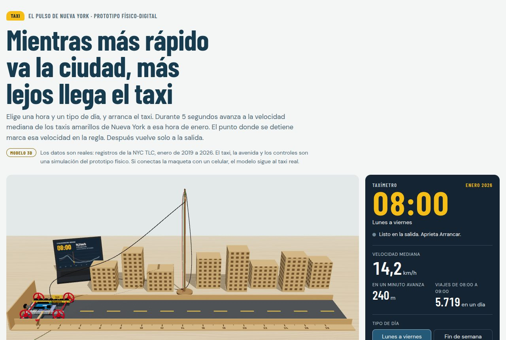
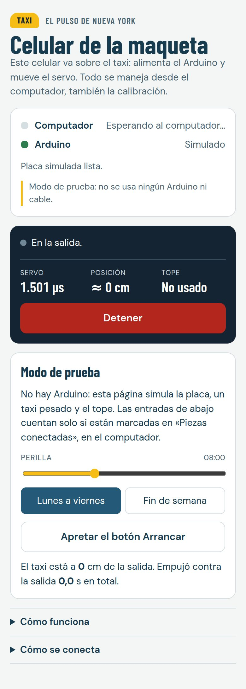
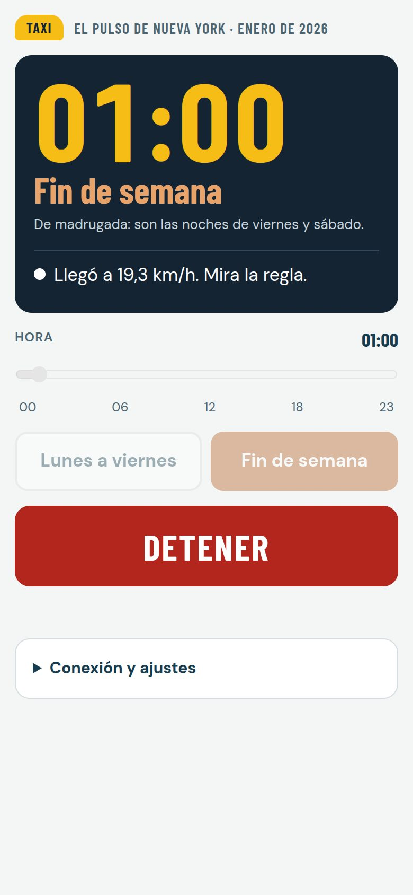

IIC2026 Visualización de Información · Entrega 2 · El proceso de diseño: la visualización salta al mundo físico

<h1>El pulso de Nueva York, en una avenida de cartón</h1>

Un taxi de juguete avanza 5 segundos a la velocidad mediana de los taxis amarillos de Nueva York a la hora que eliges, en enero de 2026. Mismo tiempo, más lejos: más rápido.

<dl>
<dt>Grupo</dt><dd>16</dd>
<dt>Integrantes</dt><dd>Vicente Reñasco · David Parra · Mariano De Sarratea</dd>
<dt>GitHub Pages</dt><dd><a href="https://v1tso.github.io/Visualizacion_de_Informacion_Grupo_16/modelo1/">v1tso.github.io/Visualizacion_de_Informacion_Grupo_16/modelo1/</a> · cada versión en <a href="https://v1tso.github.io/Visualizacion_de_Informacion_Grupo_16/versiones/">/versiones/</a></dd>
<dt>Repositorio</dt><dd><a href="https://github.com/V1TSO/Visualizacion_de_Informacion_Grupo_16">github.com/V1TSO/Visualizacion_de_Informacion_Grupo_16</a> · tags <code>e2-v1</code> a <code>e2-v4</code></dd>
<dt>Video demostrativo</dt><dd>[completar: enlace público de YouTube al video de la V4]</dd>
</dl>

**Orden real del proceso.** V1 → R1 → V2 → R2 → R3 → V3 → V4. La R2 (pares) y la R3 (docentes) revisaron la V2, porque la V3 todavía no existía. La V3 y la V4 se hicieron el 26 de noviembre, el día de la entrega. El atraso es nuestro, y lo dejamos visible en las fechas y en el historial en vez de reordenarlo.

## Contexto general

### Propósito de la fisicalización
<!-- máx 10 -->
En la pantalla de la E1, la velocidad de los taxis era una cifra en el taxímetro y una curva. Se podía leer, pero no se sentía la diferencia entre 12,5 km/h a las 11:00 de un día de semana y 27,4 km/h a las 05:00 del fin de semana (enero de 2026). En la maqueta, la velocidad mediana de cada hora se vuelve distancia: un taxi de juguete avanza 5 s a esa velocidad y su aguja se detiene sobre una regla de 0 a 28 km/h. En el mismo tiempo, el taxi del fin de semana a las 05:00 llega más del doble de lejos que el de las 11:00 de un día de semana. Desde la V3, la carrera se elige tocando el taxi mismo: el celular que lleva encima es su taxímetro. Una voz dice qué carrera es, y el sonido sale del taxi mientras avanza: el tono sigue la velocidad y la bocina marca el tráfico lento. En la R2, el otro grupo destacó justamente que lo físico «permite contrastar la velocidad», mientras que en la pantalla «tiene otros distractores».

### Procesamiento de los datos
<!-- máx 8 -->
- Mismos datos de la E1 (NYC TLC, `public/data/years.json`): velocidad mediana por hora de salida (distancia / duración, viajes de 1 minuto a 3 horas) de toda la ciudad, en un día de lunes a viernes y en uno de fin de semana.
- Ajuste para la maqueta: la regla va de 0 a 28 km/h. Las pocas horas sobre 28 km/h quedan al final de la regla (en enero de 2026 no hay ninguna; el máximo es 27,4).
- V3: solo enero de 2026, en 48 valores dentro del celular (`public/modelo1/datos.js`). Se dejó de sonificar la cantidad de viajes (ver V3).

## V1 — la idea completa (aunque simulada)

### Identificación
3 de noviembre de 2026 · tag [`e2-v1`](https://github.com/V1TSO/Visualizacion_de_Informacion_Grupo_16/tree/e2-v1) (commit `5532f7c`, PR #3) · publicada en [/e2/v1/modelo1/](https://v1tso.github.io/Visualizacion_de_Informacion_Grupo_16/e2/v1/modelo1/).

### Evidencia

[completar: foto de bocetos o del cartón de la V1, si hubo. Video corto del modelo 3D con sonido.]

### Qué cambió: las decisiones iniciales
<!-- máx 8 -->
- Fisicalización: la velocidad de la hora elegida se vuelve distancia. El taxi avanza 5 s y su aguja la marca en una regla de 0 a 28 km/h, con una banderita azul (lun–vie) o naranja (fin de semana).
- Interacción: caja con perilla de hora, interruptor de día y botón Arrancar. El taxi vuelve solo, en silencio.
- Sonido en la ida: tono = velocidad, ritmo = viajes, bocina bajo 15 km/h, izquierda/derecha = tipo de día.
- Capa digital: el computador muestra hora, velocidad y curvas. Un Arduino, con un cable colgado de un poste, lee la caja y mueve el servo.
- Mago de Oz: un modelo 3D interactivo de la maqueta mientras llegaban los materiales.

### Por qué cambió — el rationale
<!-- máx 12 -->
- La posición sobre una escala común es la señal que mejor se compara (cap. 16). Por eso la velocidad es una distancia en la regla, y no un ángulo o un color.
- Con el tiempo fijo (5 s), la distancia es proporcional a la velocidad: la metáfora del taxi que «llega más lejos» calza con el dato.
- La vuelta no codifica datos y es siempre igual y en silencio, para que no compita con la ida (cap. 20: solo lo que suma al mensaje).
- El sonido repite la velocidad con el tono y agrega los viajes con el ritmo (cap. 27), en estéreo para separar los tipos de día, como en la E1.
- Prototipar primero en virtual, con baja fidelidad física (cap. 29), permitió discutir la experiencia completa antes de cortar cartón.

### Qué se descartó
<!-- máx 5 -->
[completar: alternativas que el grupo discutió y descartó para la V1, con su motivo.]

## R1 — revisión con el equipo docente
<!-- máx 10 -->
[completar: fecha · síntesis de lo discutido sobre la V1 (modelo 3D) · qué adoptamos, qué descartamos y por qué · cómo se ve en la V2.]

## V2 — primera iteración de diseño

### Identificación
19 de noviembre de 2026 · tag [`e2-v2`](https://github.com/V1TSO/Visualizacion_de_Informacion_Grupo_16/tree/e2-v2) (PR #4: commits `1599186` y `d14308d`) · publicada en [/e2/v2/modelo1/](https://v1tso.github.io/Visualizacion_de_Informacion_Grupo_16/e2/v2/modelo1/).

### Evidencia

[completar: fotos del taxi con el celular encima y de la regla, y un video de una carrera con su sonido.]

### Qué cambió
<!-- máx 8 -->
- La maqueta se mueve de verdad. Un celular Android va sobre el taxi, alimenta al Arduino por un cable OTG y mueve el servo. El computador lo controla por Protobject.
- El ciclo (5 s de ida, 3 s de pausa y vuelta) corre en el celular, junto al servo. El modelo 3D y el sonido del computador siguen al taxi real.
- Los controles pasan al computador (hora, tipo de día, Arrancar). La caja de controles queda opcional.
- Calibración con el peso real: se mide hasta dónde llega la aguja con cada pulso y se interpola el pulso de cada velocidad.

### Por qué cambió — el rationale
<!-- máx 12 -->
- Fidelidad (cap. 29): de la simulación de la V1 a una maqueta que se mueve, para discutir en la R2 la experiencia real y no una promesa. [completar: qué pidió la R1]
- El celular como actuador y fuente de energía (cap. 30, con Protobject): sin el cable colgado del poste, el taxi recorre la avenida sin nada que lo frene ni lo desvíe.
- Con el celular sobre el taxi, su pantalla parecía fuera de alcance, así que todo pasó al computador. La entrada perdió tangibilidad, a sabiendas: la R2 y la R3 lo confirmaron, y la V3 lo corrige.
- Restricción técnica: el celular pesa [completar] g. Con el mismo pulso, el taxi avanzaba menos y la aguja marcaba otra velocidad. El pulso fija la velocidad que el servo intenta alcanzar, no su fuerza, así que se calibra lo que se lee: la distancia sobre la regla (cap. 16).
- El ciclo vive en el celular porque la red puede atrasarse, y el taxi debe detenerse a tiempo en la salida.

### Qué se descartó
<!-- máx 5 -->
- Controles en la pantalla del celular: sobre el taxi parecían fuera de alcance (la V3 lo retoma).
- Calibrar la «fuerza» del servo: el pulso solo fija la velocidad, así que se calibra la distancia.
- Estimar la vuelta como pulso × tiempo: con el peso del celular, el taxi seguía empujando contra la salida.
- Celular fijo junto a la avenida, con un cable de 2 m hasta el taxi: [completar: por qué lo pusimos arriba].

## R2 — revisión entre pares
<!-- máx 10 -->
**Fecha:** [completar]. Presentamos la V2.
**Síntesis:** entendieron que el auto simula la velocidad de los taxis de Nueva York, pero tuvimos que explicarles que era un taxi y el contexto. Para ellos, lo físico representa la velocidad, pero no es una interacción tangible: «no hicimos nada, el auto cambiaba con los cambios de la pantalla». Sin la pantalla, la velocidad «no tiene contexto» (qué hora, qué día). Recomendaron conservar el auto. Pidieron una voz o sonido que diga el día y la hora, y que el auto se lea como taxi (cartón y colores).
**Decisiones:** adoptamos la voz (V3), porque en el objeto fallaba la heurística «falta contexto». Adoptamos decorar el taxi (V4). «No supimos cómo interactuar» mostró que el problema era la entrada en el computador: la V3 lleva los controles al taxi. Conservamos el auto y el mapeo velocidad → distancia. Descartamos agregar lugares y fechas al objeto: su mensaje es la velocidad por hora y tipo de día, y más variables lo saturarían (cap. 20).

## R3 — revisión con el equipo docente
<!-- máx 10 -->
**Fecha:** [completar]. Revisó la V2.
**Síntesis:** sacar el modelo 3D de la página. Dejar los controles lo más simples posible, para darle el peso a la fisicalización. Usar los controles directamente desde el celular, de modo que la página casi no haga falta para entender la maqueta.
**Decisiones:** adoptamos las tres (V3). Eso revierte un descarte de la V2 («controles en el celular: fuera de alcance»). Con la pantalla hacia arriba, el celular se alcanza cuando el taxi está en la salida, y tocar el taxi mismo es el gesto tangible que la R2 echó de menos. El 3D era la simulación de la V1. Con la maqueta real, duplicaba el objeto y dividía la atención (cap. 20). Descartamos eliminar el computador: hace falta para unir el celular (QR de Protobject) y para calibrar, porque hay que escribir centímetros. Queda opcional y sin controles de la carrera.

## V3 — segunda iteración de diseño

### Identificación
26 de noviembre de 2026 · tag [`e2-v3`](https://github.com/V1TSO/Visualizacion_de_Informacion_Grupo_16/tree/e2-v3) (commit `e3ee8da`) · publicada en [/e2/v3/modelo1/](https://v1tso.github.io/Visualizacion_de_Informacion_Grupo_16/e2/v3/modelo1/).

### Evidencia

Capturas en modo de prueba (`?prueba`): el computador muestra carreras simuladas. [completar: fotos del celular sobre el taxi y video de una carrera con la voz y el sonido.]

### Qué cambió
<!-- máx 8 -->
- El celular sobre el taxi es su taxímetro: hora en grande, un slider de hora, dos botones de día y un botón Arrancar, que se vuelve Detener durante la carrera. Trae los datos, así que no necesita el computador.
- Antes de salir, una voz dice la carrera: «Fin de semana, a la una de la madrugada».
- El sonido sale del celular y viaja con el taxi. El tono sigue la velocidad, el ritmo es fijo, el timbre marca el tipo de día (sine o triangle) y la bocina suena bajo 15 km/h.
- La página del computador pierde el 3D, el sonido y los controles. Solo une el celular, calibra y anota cada carrera sobre la curva del día.
- Solo enero de 2026: se quitó el selector de año.

### Por qué cambió — el rationale
<!-- máx 12 -->
- R2, «no hicimos nada»: fallaba «la interacción física no es descubrible». El control va en el taxi mismo, con tres controles visibles: hora, día y botón.
- R3: con la maqueta real, el 3D ya no cumplía su papel de Mago de Oz (cap. 29) y competía con el objeto (cap. 20).
- R2, sin contexto: la voz da la hora y el día sin leer la pantalla. Es habla y no un earcon porque es un dato categórico que debe entenderse sin explicación (cap. 27).
- Restricción técnica: el parlante del celular es mono, así que el estéreo de la E1 ya no separa los días; lo reemplazan el timbre y la voz. La escala sube una octava porque el parlante casi no da graves.
- Ritmo fijo: los viajes no son parte del mensaje de la maqueta, y en un parlante tono y ritmo variando juntos competían (cap. 20).
- Solo 2026 (R3, simplicidad): el patrón por hora se repite en los ocho eneros (E1, V4).

### Qué se descartó
<!-- máx 5 -->
- Un segundo celular como control remoto: separa el gesto del objeto y suma otra conexión.
- Eliminar el computador: hace falta para unir (QR) y calibrar.
- Que la voz diga la velocidad: la lectura es la regla, y la voz solo da el contexto.
- Mantener el 3D como capa opcional: la R3 pidió sacarlo, y sigue publicado en `/e2/v1/` y `/e2/v2/`.

## V4 — la experiencia final

### Identificación
26 de noviembre de 2026 · tag [`e2-v4`](https://github.com/V1TSO/Visualizacion_de_Informacion_Grupo_16/tree/e2-v4) ([completar: commit]) · publicada en [/modelo1/](https://v1tso.github.io/Visualizacion_de_Informacion_Grupo_16/modelo1/).

### Evidencia
[completar: fotos del taxi decorado sobre la avenida y video final con manipulación, voz y sonido (el mismo del enlace de la portada).]

### Qué cambió
<!-- máx 8 -->
- El taxi se lee como taxi sin mirar la pantalla: [completar: cómo lo decoraron (cartón amarillo, letrero TAXI, franja a cuadros…)].
- [completar: lo que cambió al probar la V3 en la maqueta real (volumen, voz, alcance del slider, toques que empujan el taxi…).]

### Por qué cambió — el rationale
<!-- máx 12 -->
- R2: «falta algo que dé a entender que se trata de un taxi sin tener que leer la pantalla; si no, se entiende como un vehículo genérico». La forma del objeto tiene que nombrar el dato: la velocidad es de taxis amarillos, no de autos en general. [completar con lo observado]
- [completar: rationale de cada ajuste salido de la prueba de la V3.]

### Qué se descartó
<!-- máx 5 -->
[completar]

### Balance del recorrido
- **Mejoró desde la V1:** la maqueta pasó de simulación (V1) a objeto que se mueve (V2) y a objeto que se maneja tocándolo (V3). El contexto de cada carrera pasó de la pantalla a la voz (V3). El sonido pasó del computador al taxi, con un solo parlante y menos variables (V3). El taxi se lee como taxi (V4).
- **No cambió, a propósito:** velocidad → distancia en 5 s fijos sobre una regla común de 0 a 28 km/h (cap. 16), la vuelta en silencio, la bocina bajo 15 km/h y el auto como forma (la R2 pidió conservarlo).

## El feedback al otro grupo (lo que dimos en la R2)

### El proyecto evaluado
<!-- máx 5 -->
Grupo [completar: número], sobre estadios de fútbol y su capacidad. Su prototipo es una maqueta de estadio con un sensor de fuerza: al apretarla, la pantalla llena el estadio de puntos y mueve un medidor de colores según la fuerza. Lo vimos y lo manipulamos en estado [completar: cómo estaba: maqueta de cartón con sensor funcionando, pantalla en el computador…].

### El feedback que dimos
<!-- máx 12 -->
- Mensaje: la maqueta representa un estadio con la capacidad de personas que soporta, y al apretarla la pantalla refleja esa fuerza como gente que entra.
- Lo físico es solo una interacción tangible, no una fisicalización del dato: la fuerza se traduce en gente en la pantalla. Aporta la sensación de «llenar» el estadio con el propio cuerpo.
- Conservar: apretar el modelo es intuitivo y fácil, y la interfaz responde rápido a lo que se quiere transmitir.
- Cambiar 1, diferenciar estadios según su capacidad: hoy la misma fuerza sobre estadios de distinta capacidad da el mismo resultado, así que el gesto no codifica el dato que los distingue. Propusimos ponderar el ángulo del medidor por la capacidad de cada estadio, para que la diferencia sea notoria.
- Cambiar 2, pintar la cancha: el objeto tiene que decir qué representa sin leer la pantalla.

### Lo que nos llevamos para nuestro proyecto
<!-- máx 5 -->
- «Pintar la cancha» es el mismo error que nos señalaron a nosotros con el taxi genérico: lo adoptamos en la V4.
- Su gesto de apretar responde al tiro. Contrastaba con nuestra V2, donde nadie tocaba nada, y confirmó llevar los controles al taxi (V3).
- [completar: otra idea, si la hubo.]

## Evaluación con usuarios

**No hicimos la ronda de pensar en voz alta con una persona externa.** [completar: el motivo real.] No reconstruimos una sesión que no ocurrió. Por eso la bitácora, las heurísticas y las tres respuestas de cierre quedan vacías.

- **Pensador:** no hubo.
- **Bitácora (tiempo · cita literal · acción física):** no hay.
- **Qué dijo del sonido:** nadie externo lo comentó. Las únicas observaciones del sonido vienen de la R2, que no siguió la hoja del observador. Pidieron voz para el contexto, y la adoptamos en la V3.
- **Heurísticas que fallaron:** sin sesión, no las marcamos. En la R2 aparecieron dos: «falta contexto» y «la interacción física no es descubrible». Las tomamos como evidencia de pares, no de usuarios.
- **Atasco, hipótesis equivocada y cambio concreto:** no aplican.
- **Efecto en el proceso:** ninguno de una evaluación con usuarios. La V3 y la V4 se apoyan en la R2, la R3 y las pruebas del grupo con la maqueta real. Con una ronda habríamos probado tres hipótesis abiertas:
  - si el slider sobre el taxi se descubre sin explicación;
  - si la voz se entiende con el ruido del servo;
  - si el timbre distingue el tipo de día sin la voz.
